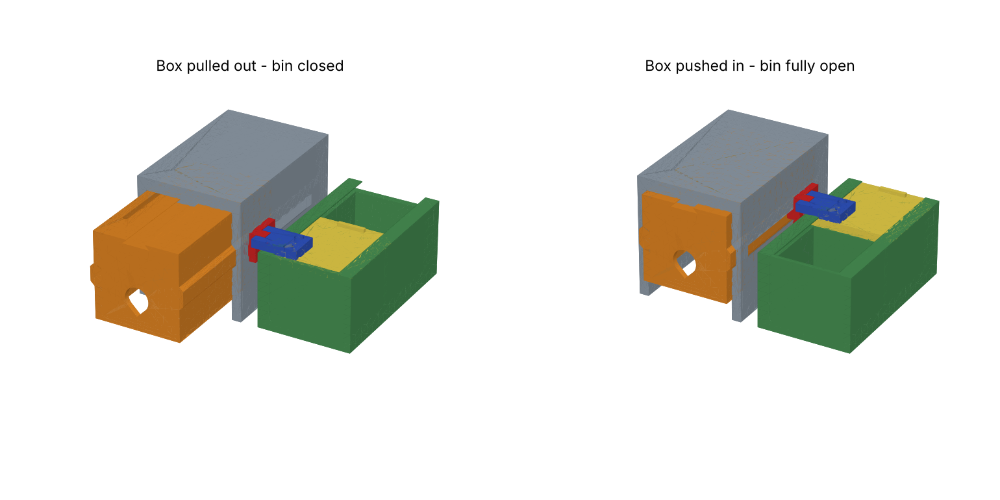
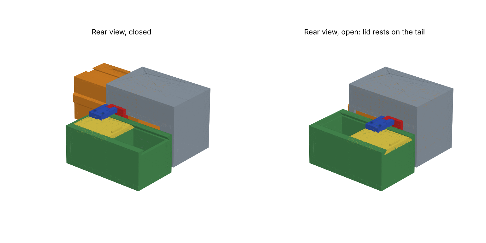
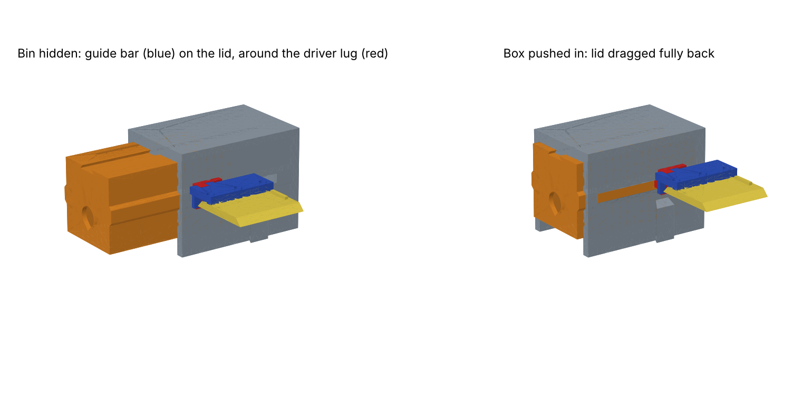
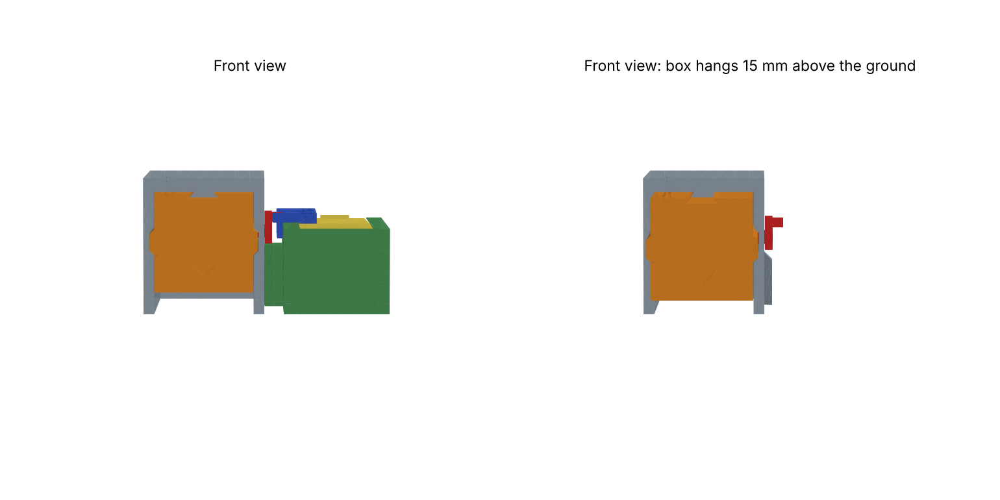

# Feeding station for a donkey with diabetes – printable scale model (version 2)

A small model of a feeding station: the donkey pushes a **box** into a hollow
**shell**, which slides the lid of the **food bin** completely off. The bin stays
locked for as long as the box is pulled out.

Overall size: **163 mm wide × 193 mm deep × 90 mm high** (limit 200 × 200 × 150),
measured with the box pulled out.

## How it works

| Feature | How the model does it |
|---|---|
| Box on rails, only in and out of the front | The box runs on **three rails**: one on each side and a dovetail rail along the roof that the box hangs from. Its bottom stays **15 mm above the ground**, so rough ground doesn't get in the way. A red **driver block** is screwed to the box through a slot in the shell wall. The slot is closed at both ends, so the box slides 60 mm and can never leave the shell. A screw through the roof is a second stop. |
| Bin opens only when the box is pushed in | The lid slides in undercut rails. A **catch** (blue) screwed on top of the lid fits around a lug on the driver block, so the lid follows the box exactly. Box out means the bin is closed and locked; box in means the lid has moved 60 mm back. |
| Whole bin reachable | The food opening is 57 mm long and the lid moves 60 mm, so the open lid is completely clear of the opening. |
| Open lid supported | Behind the bin is a **support tail**: the bin's side walls, the lid rails, a floor and an end wall carry on for another 60 mm. The open lid lies on rails along its whole length instead of hanging over air. |
| Bin can be moved between stations | The bin, with its lid and catch, drops from above onto a dovetail on the shell and lifts straight off again. |

## Parts to print (`stl/`, already in print orientation, no supports needed)

| File | Part | Printed | Size (mm) |
|---|---|---|---|
| `1_shell.stl` | Shell | on its roof | 86 × 120 × 90 |
| `2_box.stl` | Push box | on its top | 71 × 120 × 66 |
| `3_driver.stl` | Driver block | standing on its front end | 17 × 21 × 26 |
| `4_bin.stl` | Food bin with support tail | upright | 83 × 127 × 57 |
| `5_lid.stl` | Sliding lid | flat | 60 × 63 × 9 |
| `6_lid_catch.stl` | Lid catch | on its top | 34 × 22 × 7 |

Suggested settings: PLA or PETG, 0.2 mm layers, **4 walls, 25–30 % infill**
(this is what makes it strong), no supports. All overhangs are 45° or less.

These parts are all new. None of the version 1 parts fit this design.

## Screws needed (no glue, springs or string)

- 2 × M3 × 16 mm: driver block to the box
- 1 × M3 × 12 mm: roof stop
- 2 × M3 × 10 mm: catch to the lid

All screw heads must be no wider than 6 mm. The screws cut their own thread in
the 2.7 mm holes.

## Assembly (in this order)

1. **Box into the shell:** slide the box in from the front, with its side rails
   in the side grooves and the groove in its top over the roof rail. Pull it
   fully out again.
2. **Driver block:** hold it against the outside of the shell on the dovetail
   side, with its ridge in the wall slot and its lug at the top pointing away
   from the shell. Screw it to the box with the two M3 × 16 screws. Do not
   overtighten; the box must still slide.
3. **Roof stop:** turn the M3 × 12 screw into the hole in the roof.
4. **Lid:** slide the lid into the rails from the **back end of the tail**
   and push it forward until it stops against the front lip.
5. **Catch:** put it on the front-left corner of the lid, with the notch over
   the left rail, and fasten it with the two M3 × 10 screws.
6. **Bin onto the station:** with the box **pulled out**, lower the bin onto the
   dovetail. The notch in the catch drops over the driver lug.

Push the box in and the lid slides fully back onto the tail. Pull the box out
with the finger hole and the lid closes.

To refill, lift the bin off (box pulled out). Off the station, the lid can be
slid back by hand, or slid off the back of the tail.

## Checked in CAD

`python3 build.py` rebuilds every part and checks these things:

- **Every assembly step above:** each part is moved along its real assembly
  path in small steps and must not hit anything. That includes lowering the
  bin past the driver block.
- **Working:** box and lid are moved together over the full 60 mm in 2 mm
  steps, with no collisions. The open lid clears the food opening and lies
  fully on the rails.
- **Locks:** the lid cannot open while the box is out, cannot be lifted, and
  cannot slide off the front. The box cannot leave the shell or drop down,
  and it hangs on the top rail. The bin cannot be pulled sideways.

The model has been checked in CAD, not test-printed. `CLR` at the top of
`build.py` is the sliding clearance (0.35 mm); raise it if parts come out too
tight on your printer. `python3 render.py` redraws the pictures.
