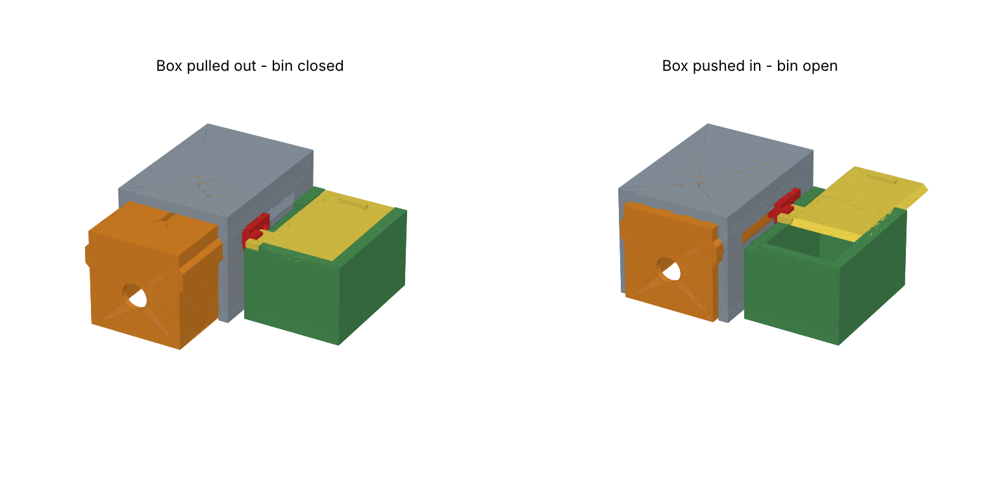
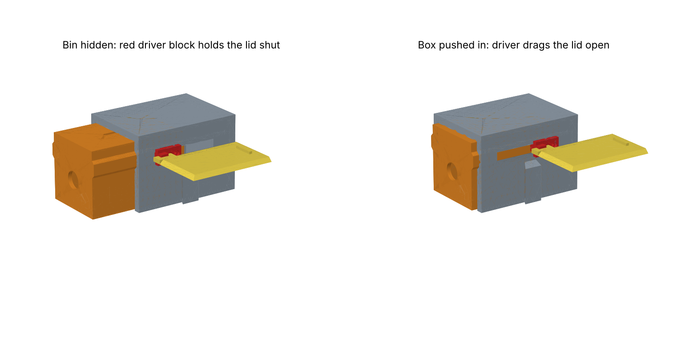

# Feeding station for a donkey with diabetes – printable scale model

A small model of a feeding station: the donkey pushes a **box** into a hollow
**shell**, and that opens the lid of the **food bin** on the side. The bin stays
locked for as long as the box is pulled out.

Overall size: **154 mm wide × 186 mm deep × 75 mm high** (limit was 200 × 200 × 150).

## How it works

| Key feature | How the model does it |
|---|---|
| Box on a rail, can only move in and out of the front | The box has a rail on each side that hangs in a groove in the shell walls. A red **driver block** is screwed to the box *through a slot in the shell wall*. The slot is closed at both ends, so the box slides 40 mm and can never leave the shell. A screw through the roof is a second stop. |
| Bin opens only when the box is pushed in | The bin has a sliding lid. A notch in the lid sits over a lug on the driver block, so the lid follows the box exactly: box out = closed, box in = open 40 mm. The lid runs under undercut rails, so it cannot be lifted or slid by hand while it is on the station. |
| Bin can be moved between stations | The bin drops from above onto a dovetail on the shell side and lifts straight off again. Taken off the station, the lid slides off the back for refilling. |

The shell is open at the floor and the front, as asked. The one deviation: the
side wall has a narrow slot for the driver block, which the mechanism needs.

## Parts to print (`stl/`, already in print orientation, no supports needed)

| File | Part | Printed |
|---|---|---|
| `1_shell.stl` | Shell | on its roof |
| `2_box.stl` | Push box | on its roof |
| `3_driver.stl` | Driver block | standing on its front end |
| `4_bin.stl` | Food bin | upright |
| `5_lid.stl` | Sliding lid | flat |

Suggested settings: PLA or PETG, 0.2 mm layers, **4 walls, 25–30 % infill**
(this is what makes it strong), no supports.

## Other things needed

- 2 × M3 × 16 mm screw (driver block), head no wider than 6 mm
- 1 × M3 × 10 mm screw (roof stop)

The screws cut their own thread in the 2.7 mm holes. No glue, springs or string needed.

## Assembly

1. Slide the box into the front of the shell, rails in the grooves.
2. Put the driver block against the outside of the shell (bin side), its ridge
   in the slot and its lug **towards the front, pointing away from the shell**.
   Fasten it to the box with the two M3 × 16 screws. Do not overtighten – the
   box must still slide.
3. Turn the M3 × 10 screw into the hole in the roof.
4. Slide the lid into the bin from the back until it stops.
5. Pull the box fully out, then lower the bin onto the dovetail; the notch in
   the lid drops over the lug.

Push the box in: the bin opens. Pull it out with the finger hole: the bin closes.

## Changing the design

Everything is generated by `build.py` (CadQuery). The dimensions are at the top
of the file; `CLR` is the sliding clearance (0.35 mm) – raise it if the parts
come out too tight on your printer. `python3 build.py` rebuilds the STL/STEP
files and re-runs the fit checks (no part collides in any position, and the lid,
box and bin are blocked in every direction they should be). `python3 render.py`
redraws the pictures.

The model has been checked in CAD, not test-printed yet.
